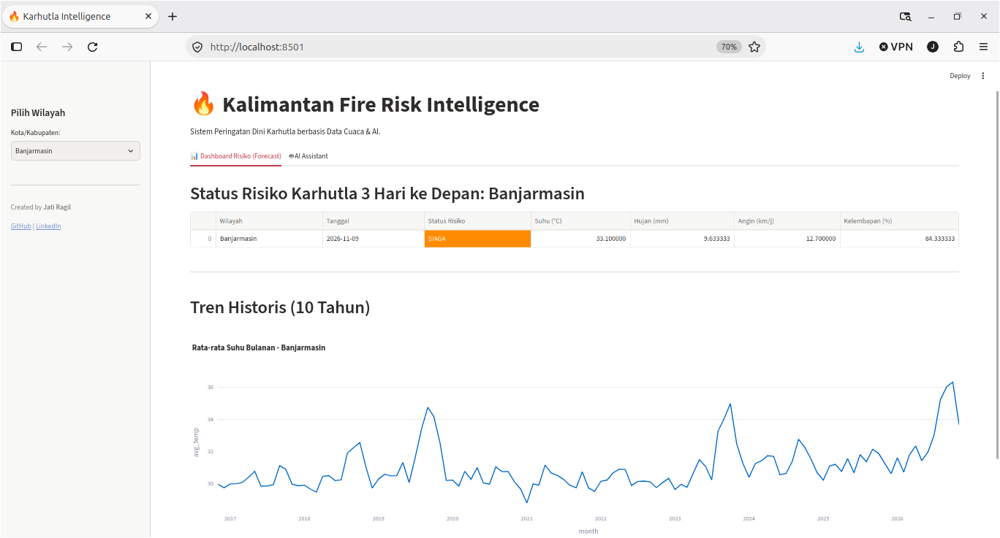
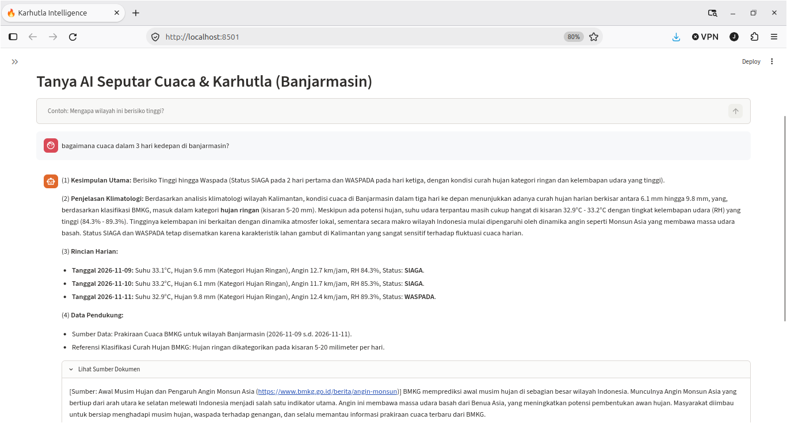
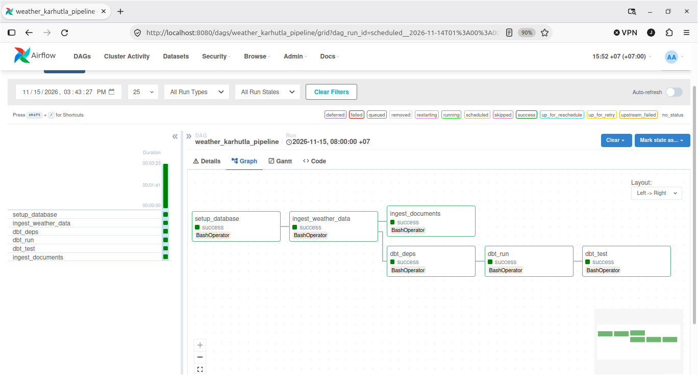

# Kalimantan Peatland Fire Risk Intelligence

An End-to-End Data & AI Pipeline for Peatland Fire Risk Mitigation in Kalimantan.
Bridging the gap between raw weather data and actionable fire risk intelligence.

## **Why this project?**

Most of my previous projects relied on clean, pre-packaged e-commerce datasets. I wanted to build something with actual friction. Peatland fires (Karhutla) in Kalimantan presented a perfect engineering challenge: it's a messy, high-stakes problem where a single miscalculated threshold or a hallucinated AI response can actually mean a false alarm (or worse, a missed one). I built this pipeline to see if a Modern Data Stack could handle the unpredictability of real-world climatology.


*Dashboard showing 5-level risk assessment (Calibrated via P90 historical data).*


*Hybrid RAG Assistant answering a query with contextual citations from BMKG documents.*

## 📂 Project Structure

```text
kalimantan-fire-risk-rag-pipeline/
├── dags/                  # Airflow DAG definitions
├── dashboard/             # Streamlit UI (app.py) - Pure UI, decoupled from AI
├── data/                  # Raw documents (PDFs, HTML, TXT, OCR caches)
├── docs/                  # Screenshots for README
├── src/                   # Core logic & pipelines
│   ├── ingest_weather.py  # Open-Meteo ingestion
│   ├── ingest_documents.py# Multi-format OCR, Markdown tagging & chunking
│   └── rag_engine.py      # Hybrid RAG logic, SQL fetching & Fallback strategy
├── weather_analytics/     # dbt project (Staging, Marts, Schema)
├── evaluate.py            # Automated Golden Dataset Evaluator (CI/CD ready)
├── .env.example           # Environment variables template
├── docker-compose.yml     # Airflow orchestration
├── requirements.txt       # Python dependencies
└── README.md
```

## Architecture & Data Flow

### ⚙️ Orchestration

*Airflow DAG showing the successful execution of the weather ingestion, dbt transformation, and document embedding.*

This project uses a **Dual-Pipeline architecture** with a strong separation of concerns:

- **Weather Pipeline (Structured Data):** Python fetches 10 years of historical data and 7 days of forecast from Open-Meteo API. It is stored in Neon PostgreSQL, transformed via dbt, and modeled into a Star Schema.
- **Knowledge Pipeline (Unstructured Data):** A multi-format document ingestion pipeline processes BMKG PDFs (born-digital and scanned) and HTML. It performs OCR, *Two-Tier Dynamic Chunking*, enriches chunks with `JSONB` metadata, and stores them in pgvector using Gemini Embeddings.
- **Orchestration:** Airflow (Dockerized) schedules the weather ingestion and dbt transformations. Document ingestion is run as a dedicated batch script (`ingest_documents.py`) to safely manage local memory limits during OCR.
- **Serving (Separation of Concerns):** Streamlit (`dashboard/app.py`) acts purely as the UI layer. The complex Hybrid RAG logic, SQL fetching, and Multi-Provider Fallback strategy live entirely in `src/rag_engine.py`.

## Key Engineering Decisions

- **Rule-Based Climatology over ML:** Wildfire ML requires historical labeled hotspot data (which is scarce). I used a transparent, rule-based approach aligned with the Fire Weather Index (FWI) standard, calculating risk using a 7-day rolling window of Temperature, Rain, Wind, and RH.
- **The "Hybrid RAG" Trick:** LLMs lack numerical precision. I built a hybrid system where Python fetches exact weather numbers via SQL, while pgvector retrieves contextual BMKG rules. The AI is forced to be a *narrator, not a calculator*.
- **Human-in-the-Loop OCR:** Tesseract struggles with layout detection. Instead of using heavy libraries (Marker/Surya) that would exceed the 3.3GB RAM limit, I implemented a *Manual Markdown Tagging* (`## BAB I`) workflow on the OCR output, guiding the chunker to perfectly parse the structure.
- **Two-Tier Dynamic Chunking:** The system splits text by Markdown headers. If OCR text is too messy and lacks headers, a `force_split_text` fallback splits the text every 800 characters to prevent LLM *"Lost in the Middle"* context loss.
- **Metadata-Aware Retrieval:** Chunks are enriched with `JSONB` metadata (e.g., `[Bagian: BAB I]`). The retrieval system uses this metadata to strictly filter and inject the exact context into the prompt, drastically reducing hallucinations.
- **Intent-Based & Anti-Hallucination Prompting:** The LLM distinguishes between *Hybrid Queries* (Weather/SQL) and *Pure RAG Queries* (SOP/Definitions). Strict guardrails force the model to reply *"Maaf, informasi tersebut tidak disebutkan..."* if the facts are missing from the retrieved documents.
- **Graceful Degradation:** A multi-provider fallback chain (IteraCompute -> OpenRouter -> Gemini) with a strict 10-second timeout ensures the demo never breaks due to free-tier API limits.
- **Dual-Mode Database Architecture:** The pipeline is designed to be completely zero-config for local development by spinning up a local `pgvector` container. However, it is also fully compatible with cloud-native serverless databases. I developed and tested this pipeline using **Neon.tech** (Serverless Postgres) to leverage its connection pooling and auto-scaling capabilities, which can be activated simply by changing the environment variables.

## Challenges & Trade-offs

- **Surviving on 3.3GB of RAM:** Running the full Airflow stack alongside Streamlit on my 3.3GB RAM laptop caused constant OOM (Out of Memory) errors. *The Fix:* I used Docker Compose Profiles. Now, Airflow (profile: airflow) and Streamlit (profile: dashboard) never run at the same time. It forced me to deeply understand container resource isolation.

- **Trusting the Data Over My Gut:** Initially, I set the "Extreme Risk" wind speed threshold at 20 km/h. But when I ran the numbers, Kalimantan (being equatorial) rarely gets winds that high. *The Fix:* I queried the `PERCENTILE_CONT(0.90)` of 10 years of local wind data. The result was 14.5 km/h. I changed the threshold. It was a humbling reminder that domain knowledge must be backed by data, not assumptions.

- **The SQL "Edge Effect":** When using `RANGE BETWEEN INTERVAL '1 day' FOLLOWING AND '3 days' FOLLOWING` for the forecast, the last day of the dataset always yielded `NULL`. *The Fix:* I filtered out `NULL` values in the Streamlit query so the dashboard only displays valid predictions, preventing the UI from crashing.

- **The HuggingFace Deprecation (And a Schema Evolution):** Mid-development, HuggingFace changed its API policy. I migrated to Google Gemini Embeddings. The catch? Gemini outputs 768-dimensional vectors, while HuggingFace was 384. *The Fix:* I performed a database Schema Evolution (`ALTER TABLE`) to change the vector dimension without dropping the existing 10-year weather data.

- **The Schema Drift & Reproducibility Trap:** Mid-development, I added a `relative_humidity_mean` column to the database using a manual `ALTER TABLE` query. I quickly realized this was a mistake: a recruiter cloning the repo would fail because `setup_db.py` didn't have this column. *The Lesson:* I treated `setup_db.py` as the Single Source of Truth and integrated it as the **first task** inside the Airflow DAG. Now, the pipeline is truly "zero-config" from scratch.

- **The OCR Layout Blindness:** Tesseract is lightweight but blind to layout (headers, tables). Using heavy layout-aware models (Marker/Surya) would instantly exceed my 3.3GB RAM limit. *The Trade-off:* I opted for a semi-automated pipeline using Tesseract plus *Manual Markdown Tagging* (`## BAB I`). It requires 10 minutes of human review per document, but guarantees perfect structural chunking with zero memory overhead.

- **The "Lost in the Middle" Chunking Trap:** Because OCR often loses newlines, a 17-page PDF initially collapsed into just 4 giant chunks (3000+ chars). Sending this to an LLM risks losing context. *The Trade-off:* I built a `force_split_text` fallback that aggressively splits text every 800 characters. It risks cutting a sentence mid-way, but prevents the LLM from choking on oversized context windows.

- **The Intent Confusion (AI Routing):** The LLM initially blended SQL weather data and SOP documents, causing off-topic answers (e.g., answering a generic SOP question by quoting Banjarmasin's weather). *The Fix:* I implemented Intent-Based Prompting to strictly separate "Weather Queries" from "Document Queries", fixing the context routing.

- **The False Positive Evaluation Trap:** My initial `evaluate.py` script passed an AI answer because it accidentally contained the word "3" (from "3 months for FDRS"), even though the question asked for "3 days for emergency status". *The Fix:* I tightened the evaluator to check for strict phrases and validated the retrieved document types (Retrieval Hit Rate) before passing the test.

## ⚠️ Limitations

- **Forecast Smoothing (The Moving Average Trap):** The risk calculation uses a 3-day moving average for the forecast. While this reduces noise, it also means a single extreme spike (e.g., one day with 40°C) might be statistically "smoothed out" and not trigger an 'EXTREME' alert. A more sophisticated approach would use daily peak values for acute warnings.
- **Human-in-the-Loop OCR Bottleneck:** While the `ingest_documents.py` pipeline handles PDF extraction and Tesseract OCR automatically, Tesseract is blind to complex layouts. To ensure perfect chunking, I had to manually inject Markdown tags (`## BAB I`) into the OCR text. This makes the pipeline semi-automated; a fully automated layout parser (like Azure Document AI) would be needed for a zero-touch production system.
- **No Cross-Encoder Re-ranking (Intentional Trade-off):** The Hybrid RAG uses raw cosine similarity (via `pgvector`'s HNSW index) combined with `JSONB` metadata filtering. It intentionally skips a secondary Cross-Encoder re-ranker to conserve local RAM (3.3GB limit). While fast and effective for this dataset scale, enterprise-grade RAG systems often add a re-ranking step to improve retrieval precision further.
- **Rule-Based Proxy vs Physical Model:** The rule-based logic (Temperature, Rain, Wind, RH) is a simplified meteorological proxy. It is not a full physical model like the Canadian Forest Fire Weather Index (FWI), which accounts for fuel moisture codes (FFMC, DMC, DC) and deep organic soil drying.
- **Local UI vs. Dockerized Infrastructure:** Streamlit is run locally (not inside Docker) to conserve RAM on a 3.3GB machine. While this is a pragmatic trade-off for local development, a production deployment would containerize the UI alongside the orchestrator.
- **LLM Fallback Latency:** While the Multi-Provider Fallback (Gemini -> Itera -> OpenRouter) ensures high availability, the free-tier APIs can occasionally experience cold starts or rate-limit delays, adding a few seconds of latency to the chatbot response.

## 🚀 How to Run (Zero-Config with Docker)

This project is fully **Dockerized** and **Zero-Config**. By default, it spins up a local PostgreSQL (with `pgvector`) container, so you don't need to manually set up any external database (like Neon). Just follow these steps:

### 1. Clone & Setup Environment
```bash
git clone https://github.com/jatiragil/kalimantan-fire-risk-rag-pipeline.git
cd kalimantan-fire-risk-rag-pipeline
cp .env.example .env
```
Note:
- Open .env and only fill in your GEMINI_API_KEY (required). You can generate a free API key at [Google AI Studio](https://aistudio.google.com/apikey).
- The DATABASE_URL is already pre-configured to use the local Docker Postgres (postgres-lokal). You don't need to change it unless you specifically want to use Neon.tech.
- ITERACOMPUTE_API_KEY and OPENROUTER_API_KEY are optional (used for the Multi-Provider Fallback chain).

### 2. Start Airflow & Database (Docker)
```bash
docker compose up -d --build
```

(This will start Airflow, its internal metadata DB, and the local pgvector DB. It might take 2-3 minutes on the first build).

### 3. Run the Pipeline (Airflow UI)

- Open http://localhost:8080 (Username: admin, Password: admin).
- Find the DAG named weather_karhutla_pipeline.
- Unpause the DAG (toggle button on the left) and click the Play (▶️) button.
- The DAG will automatically:
    * Run setup_db.py to initialize the schema.
    * Ingest 10 years of historical weather data from Open-Meteo.
    * Run dbt run and dbt test via the provided profiles.yml.
    * Run ingest_documents.py to OCR BMKG PDFs and embed them into pgvector.

### 4. Run Streamlit (Local UI)
To save RAM on low-spec machines, Streamlit runs locally (not inside Docker). It uses a separate, lightweight requirements file.

```bash
python3 -m venv venv
source venv/bin/activate
pip install -r requirements.txt
pip install -r dashboard/requirements.txt
streamlit run dashboard/app.py
```

(Open http://localhost:8501 in your browser).

## 🧪 Evaluation: Anti-Hallucination & Guardrails

To prove the system is factual and cannot be tricked into hallucinating, I built a custom Golden Dataset `evaluate.py` (with `sys.exit(1)` for CI/CD readiness). It tests Retrieval accuracy, Guardrails, Hybrid Weather queries, and Anti-Hallucination.

**Result: 6/6 PASS (100%)**

```text
============================================================
🏆 EVALUASI RAG KARHUTLA (GOLDEN DATASET + RETRIEVAL TEST)
============================================================
⏳ [TEST 1] (Definisi): 'Apa itu FFMC dan mengapa penting?' -> ✅ PASS
⏳ [TEST 2] (SOP Umum): 'Apa maksud dan tujuan dari SOP BMKG ini?' -> ✅ PASS
⏳ [TEST 3] (SOP Spesifik): 'Siapa yang melaksanakan penyediaan informasi peringatan dini di tingkat Provinsi?' -> ✅ PASS
⏳ [TEST 4] (Guardrail): 'Siapa presiden Indonesia?' -> ✅ PASS
⏳ [TEST 5] (Cuaca Hybrid): 'Bagaimana prakiraan cuaca dan risiko karhutla di Pontianak 3 hari ke depan?' -> ✅ PASS
⏳ [TEST 6] (Trap Question): 'Berapa jumlah personel pemadam kebakaran di Pontianak tahun 2025?' -> ✅ PASS

📊 HASIL AKHIR: 6/6 LULUS (Hit Rate: 100.0%)
🎉 STATUS: SEMPURNA. Sistem RAG siap tempur!
```

*The system successfully refuses to answer out-of-scope questions, proving that the prompt engineering and RAG boundaries are working as intended. If the AI cannot find the answer in the provided SQL data or BMKG documents, it is explicitly designed to admit its limitations rather than hallucinate.*


## 🔮 Future Work

- Integrating real-time satellite hotspot data (NASA FIRMS) to replace the rule-based proxy.

- Migrating Airflow to AWS MWAA for 24/7 scheduling without local hardware constraints.

- Adding a visual map (Leaflet) for better spatial risk visualization.

---

Author: Jati Ragil
- GitHub: [@jatiragil](https://github.com/jatiragil)
- LinkedIn : [@jatiragil](linkedin.com/in/jati-ragil-19893a446)
