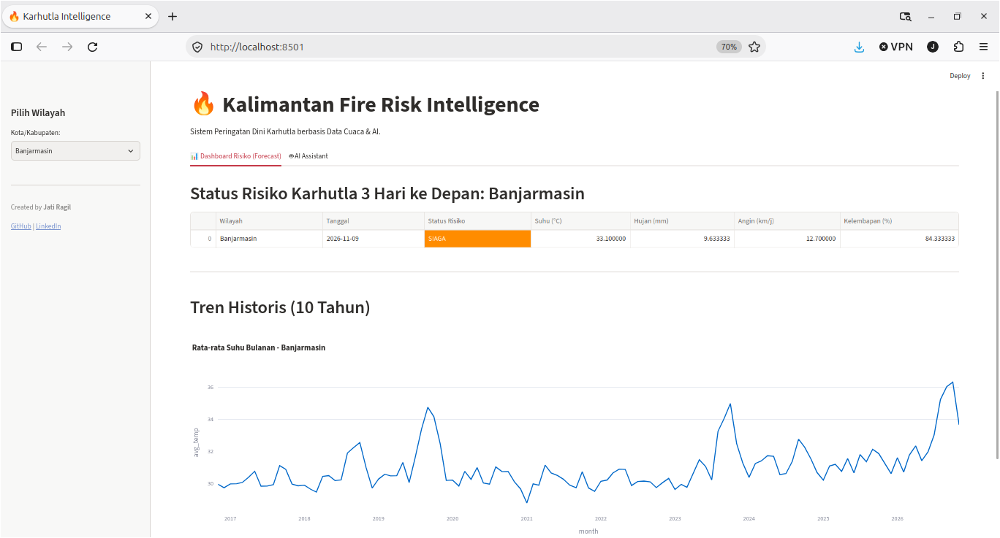
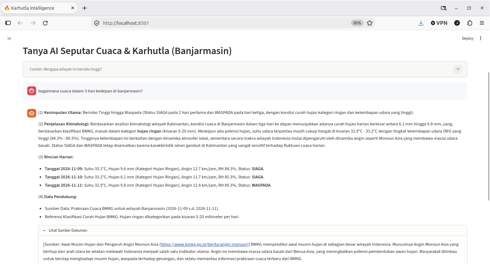
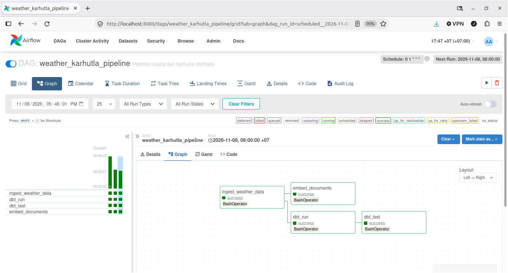

# Kalimantan Peatland Fire Risk Intelligence

An End-to-End Data & AI Pipeline for Peatland Fire Risk Mitigation in Kalimantan.
Bridging the gap between raw weather data and actionable fire risk intelligence.

## **Why this project?**

Most of my previous projects relied on clean, pre-packaged e-commerce datasets. I wanted to build something with actual friction. Peatland fires (Karhutla) in Kalimantan presented a perfect engineering challenge: it's a messy, high-stakes problem where a single miscalculated threshold or a hallucinated AI response can actually mean a false alarm (or worse, a missed one). I built this pipeline to see if a Modern Data Stack could handle the unpredictability of real-world climatology.


*Dashboard showing 5-level risk assessment (Calibrated via P90 historical data).*


*Hybrid RAG Assistant answering a query with contextual citations from BMKG documents.*

## 📂 Project Structure

```text
kalimantan-fire-risk-rag-pipeline/
├── dags/                  # Airflow DAG definitions
├── dashboard/             # Streamlit UI (app.py)
├── data/                  # Raw documents (JSON snapshots)
├── docs/                  # Screenshots for README
├── src/                   # Python ETL & Ingestion code
├── weather_analytics/     # dbt project (Staging, Marts, Schema)
├── .env.example           # Environment variables template
├── docker-compose.yml     # Airflow orchestration
├── requirements.txt       # Python dependencies
└── README.md
```

## Architecture & Data Flow

### ⚙️ Orchestration

*Airflow DAG showing the successful execution of the weather ingestion, dbt transformation, and document embedding.*

This project uses a Dual-Pipeline architecture:

- **Weather Pipeline:** Python fetches 10 years of historical data and 7 days of forecast from Open-Meteo API. It is stored in Neon PostgreSQL, transformed via dbt, and modeled into a Star Schema.

- **Knowledge Pipeline:** BMKG documents are chunked, embedded using Gemini API, and stored in pgvector.

- **Orchestration:** Airflow (Dockerized) schedules the ingestion and transformation.

- **Serving:** Streamlit displays the dashboard and serves the Hybrid RAG Chatbot.

## Key Engineering Decisions

- **Why Rule-Based Climatology?** I intentionally avoided Machine Learning. In wildfire prediction, ML requires historical labeled hotspot data (which is scarce). Instead, I used a transparent, rule-based approach aligned with the Fire Weather Index (FWI) standard. The risk is calculated using a 7-day rolling window of Temperature, Precipitation, Wind Speed, and Relative Humidity.

- **The "Hybrid RAG" Trick:** LLMs lack numerical precision. If asked "What is the temperature tomorrow?", an LLM might hallucinate. So, I built a hybrid system: Python fetches the exact numbers via SQL and injects them into the prompt, while pgvector retrieves the contextual BMKG rules. The AI is forced to be a narrator, not a calculator.

- **Graceful Degradation:** Free-tier APIs are a double-edged sword. To ensure the demo never breaks, I built a multi-provider fallback chain (IteraCompute -> OpenRouter -> Gemini) with a strict 10-second timeout. It makes the system feel robust, even under resource constraints.

## Challenges & Trade-offs

- **Surviving on 3.3GB of RAM:** Running the full Airflow stack alongside Streamlit on my 3.3GB RAM laptop caused constant OOM (Out of Memory) errors. The Fix: I used Docker Compose Profiles. Now, Airflow (profile: airflow) and Streamlit (profile: dashboard) never run at the same time. It forced me to understand container resource isolation.

- **The HuggingFace Deprecation (And a Schema Evolution):** Mid-development, HuggingFace changed its API policy. I migrated to Google Gemini Embeddings. The catch? Gemini outputs 768-dimensional vectors, while HuggingFace was 384. The Fix: I performed a database Schema Evolution (ALTER TABLE) to change the vector dimension without dropping the existing 10-year weather data.

- **Trusting the Data Over My Gut:** Initially, I set the "Extreme Risk" wind speed threshold at 20 km/h. But when I ran the numbers, Kalimantan (being equatorial) rarely gets winds that high. The Fix: I queried the PERCENTILE_CONT(0.90) of 10 years of local wind data. The result was 14.5 km/h. I changed the threshold. It was a humbling reminder that domain knowledge must be backed by data, not assumptions.

- **The SQL "Edge Effect":** When using RANGE BETWEEN INTERVAL '1 day' FOLLOWING AND '3 days' FOLLOWING for the forecast, the last day of the dataset always yielded NULL. The Fix: I filtered out NULL values in the Streamlit query so the dashboard only displays valid predictions, preventing the UI from crashing.

- **The Schema Drift & Reproducibility Trap:** Mid-development, I added a `relative_humidity_mean` column to the database using a manual `ALTER TABLE` query. I quickly realized this was a mistake: a recruiter cloning the repo would fail because `setup_db.py` didn't have this column. *The Lesson:* I treated `setup_db.py` as the Single Source of Truth and integrated it as the **first task** inside the Airflow DAG. Now, the pipeline is truly "zero-config" and reproducible from scratch.

## ⚠️ Limitations

- **Forecast Smoothing (The Moving Average Trap):** The risk calculation uses a 3-day moving average for the forecast. While this reduces noise, it also means a single extreme spike (e.g., one day with 40°C) might be statistically "smoothed out" and not trigger an 'EXTREME' alert. A more sophisticated approach would use daily peak values for acute warnings.
- **No Re-ranking in RAG:** The Hybrid RAG uses raw cosine similarity (via `pgvector`'s HNSW index) to retrieve BMKG documents. It does not implement a secondary Cross-Encoder re-ranker. While fast and sufficient for this scale, enterprise-grade RAG systems often add a re-ranking step to improve retrieval precision.
- **Static JSON Snapshot for BMKG Docs:** The current RAG uses a static JSON snapshot of BMKG documents. In a real production environment, this would be an automated scraper or RSS feed ingestion running via Airflow.
- **Rule-Based Proxy vs Physical Model:** The rule-based logic (Temperature, Rain, Wind, RH) is a simplified meteorological proxy. It is not a full physical model like the Canadian Forest Fire Weather Index (FWI), which accounts for fuel moisture codes (FFMC, DMC, DC) and deep organic soil drying.
- **LLM Fallback Latency:** While the Multi-Provider Fallback (Gemini -> Itera -> OpenRouter) ensures high availability, the free-tier APIs can occasionally experience cold starts or rate-limit delays, adding a few seconds of latency to the chatbot response.
- **Local UI vs. Dockerized Infrastructure:** Streamlit is run locally (not inside Docker) to conserve RAM on a 3.3GB machine. While this is a pragmatic trade-off for local development, a production deployment would containerize the UI alongside the orchestrator.

## 🚀 How to Run (Zero-Config with Docker)

This project is fully **Dockerized**. You don't need to manually run any database scripts. Just follow these steps:

### 1. Clone & Setup Environment
```bash
git clone https://github.com/jatiragil/kalimantan-fire-risk-rag-pipeline.git
cd kalimantan-fire-risk-rag-pipeline
cp .env.example .env
```
Note: Open .env and fill in your actual DATABASE_URL and GEMINI_API_KEY. (IteraCompute & OpenRouter are optional for the Multi-Provider Fallback).

### 2. Start Airflow & Database (Docker)
```bash
docker compose up -d --build
```

(This will start the Airflow Webserver, Scheduler, and its internal PostgreSQL. It might take 2-3 minutes on the first build).
### 3. Run the Pipeline (Airflow UI)

- Open http://localhost:8080 (Username: admin, Password: admin).
- Find the DAG named weather_karhutla_pipeline.
- Unpause the DAG (toggle button on the left).
- Click the Play (▶️) button on the right and select Trigger DAG.
- The DAG will automatically run setup_db.py, ingest 10 years of weather data, run dbt transformations, and embed BMKG documents.

### 4. Run Streamlit (Local UI)

To save RAM on low-spec machines, Streamlit runs locally (not in Docker).
```bash
python3 -m venv venv
source venv/bin/activate
pip install -r requirements.txt
streamlit run dashboard/app.py
```

(Open http://localhost:8501 in your browser).

## 🧪 Evaluation: Anti-Hallucination & Guardrails

To prove the system is factual and cannot be tricked into hallucinating, I ran a "Golden Dataset" test using a custom `evaluate.py` script. The script tests three distinct scenarios: Data Retrieval (SQL), Document Retrieval (RAG), and Out-of-Scope Guardrails.

| Test Type | Question | AI Response (Excerpt) | Expected Behavior |
| :--- | :--- | :--- | :--- |
| **In-Scope (Weather)** | *"Bagaimana cuaca besok?"* | *"(1) Kesimpulan Utama: Berisiko Tinggi (Status: Waspada Karhutla)... (2) Penjelasan Klimatologi: Suhu permukaan mencapai 32.9°C..."* | Accurate number retrieved from SQL database. |
| **In-Scope (Document)** | *"Apa itu FFMC dan mengapa penting?"* | *"(1) Kesimpulan Utama: Ya, sangat penting... (2) Penjelasan: FFMC (Fine Fuel Moisture Code) adalah indeks yang digunakan untuk mengukur kadar air..."* | Accurate definition retrieved from pgvector (BMKG doc). |
| **Out-of-Scope** | *"Siapa presiden Indonesia?"* | *"Saya adalah spesialis cuaca dan karhutla Kalimantan, saya tidak bisa menjawab di luar topik tersebut."* | **Polite Refusal.** Guardrail works perfectly. |

*The system successfully refuses to answer out-of-scope questions, proving that the prompt engineering and RAG boundaries are working as intended. If the AI cannot find the answer in the provided SQL data or BMKG documents, it is explicitly designed to admit its limitations rather than hallucinate.*


## 🔮 Future Work

- Integrating real-time satellite hotspot data (NASA FIRMS) to replace the rule-based proxy.

- Migrating Airflow to AWS MWAA for 24/7 scheduling without local hardware constraints.

- Adding a visual map (Leaflet) for better spatial risk visualization.

---

Author: Jati Ragil
- GitHub: [@jatiragil](https://github.com/jatiragil)
- LinkedIn : [@jatiragil](linkedin.com/in/jati-ragil-19893a446)
